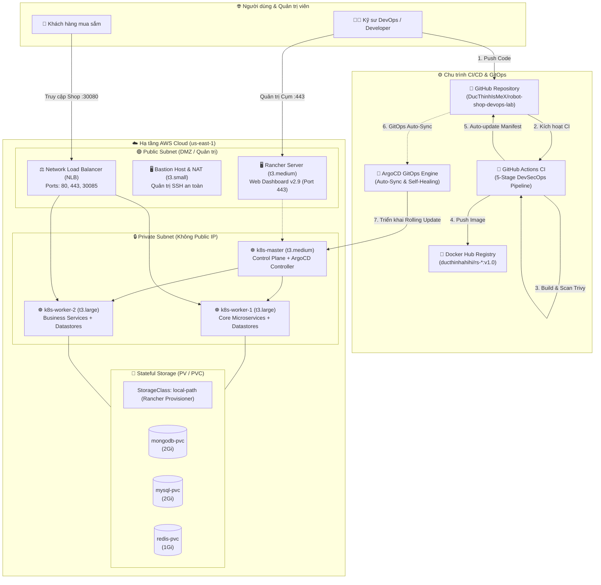

# BÁO CÁO TIẾN ĐỘ THỰC HIỆN ĐỒ ÁN CHUYÊN NGÀNH
## ĐỀ TÀI: TRIỂN KHAI VÀ TỰ ĐỘNG HÓA VẬN HÀNH HỆ THỐNG MICROSERVICES (STAN'S ROBOT SHOP) TRÊN ĐÁM MÂY AWS VỚI KUBERNETES, RANCHER VÀ QUY TRÌNH DEVOPS GITOPS

---

* **Sinh viên thực hiện:** Đức Thịnh
* **Môi trường hạ tầng:** AWS Cloud (us-east-1) - AWS Academy Learner Lab
* **Kho mã nguồn dự án (GitHub):** [DucThinhIsMeX/robot-shop-devops-lab](https://github.com/DucThinhIsMeX/robot-shop-devops-lab)
* **Kho chứa Container Image (Docker Hub):** [hub.docker.com/u/ducthinhahihi](https://hub.docker.com/u/ducthinhahihi)
* **Thời gian cập nhật:** Tháng 11/2026

---

## 1. TỔNG QUAN KIẾN TRÚC HỆ THỐNG ĐÃ XÂY DỰNG

Hệ thống được thiết kế và triển khai hoàn chỉnh theo mô hình **Cloud-Native & GitOps Enterprise**, kết hợp giữa nền tảng điều phối container hàng đầu (**Kubernetes**), hệ thống quản trị trực quan (**Rancher Dashboard**), và chu trình tự động hóa khép kín (**GitHub Actions CI + ArgoCD GitOps CD**).

---

## 2. CHI TIẾT TIẾN ĐỘ VÀ KẾT QUẢ ĐÃ ĐẠT ĐƯỢC

### 🏁 Chặng 1: Khảo sát, Sửa lỗi mã nguồn & Đóng gói Docker Images (100% Hoàn thành)
* **Khảo sát hệ thống:** Hệ thống Stan's Robot Shop gồm 10 microservices đa ngôn ngữ (Polyglot) với cơ chế lưu trữ phân tán (**Polyglot Persistence**):
  * `web`: Nginx + AngularJS.
  * `catalogue` & `user`: Node.js (kết nối MongoDB).
  * `cart`: Node.js (kết nối Redis).
  * `shipping`: Java Spring Boot (kết nối MySQL).
  * `ratings`: PHP (kết nối MySQL).
  * `payment`: Python (kết nối RabbitMQ).
  * `dispatch`: Golang (kết nối RabbitMQ).
* **Khắc phục các lỗi mã nguồn gốc:**
  1. *Ratings build failure:* Sửa lỗi Debian Bullseye mirror 404 trong `ratings/Dockerfile`.
  2. *Dispatch build failure:* Khắc phục lỗi `package slices not in GOROOT` bằng cách nâng cấp base image từ `golang:1.17` lên `golang:latest`.
  3. *MySQL/Web execution errors:* Sửa lỗi định dạng ngắt dòng Windows CRLF (`\r\n` $\rightarrow$ `\n`) và cấp quyền thực thi `chmod +x entrypoint.sh`.
* **Kết quả:** Đã build thành công và phát hành toàn bộ **10 Docker Images** lên Docker Hub cá nhân:
  * `ducthinhahihi/rs-web:v1.0`
  * `ducthinhahihi/rs-catalogue:v1.0`
  * `ducthinhahihi/rs-cart:v1.0`
  * `ducthinhahihi/rs-user:v1.0`
  * `ducthinhahihi/rs-shipping:v1.0`
  * `ducthinhahihi/rs-payment:v1.0`
  * `ducthinhahihi/rs-ratings:v1.0`
  * `ducthinhahihi/rs-dispatch:v1.0`
  * `ducthinhahihi/rs-mongodb:v1.0`
  * `ducthinhahihi/rs-mysql:v1.0`

---

### 🏁 Chặng 2: Thiết kế Hạ tầng theo mã (IaC - Terraform & Ansible) (100% Hoàn thành)
* **Mô hình mạng chuẩn bảo mật doanh nghiệp (Multi-tier VPC):**
  * Tách biệt **Public Subnet (`10.0.1.0/24`)** và **Private Subnet (`10.0.11.0/24`)**.
  * Cụm Kubernetes (Master và 2 Worker) nằm hoàn toàn trong Private Subnet, **không có Public IP**, loại bỏ 100% rủi ro bị tấn công trực tiếp từ Internet.
  * Máy chủ `edge` đóng vai trò kép: **NAT Gateway** (cấp Internet cho private subnet) và **Bastion Jump Server** (SSH ProxyJump an toàn).
* **Tích hợp máy chủ quản trị Rancher Server:**
  * Khai báo EC2 `rancher-server` (`t3.medium`, 30GB gp3) trong Public Subnet, tự động cài đặt Docker và chạy container `rancher/rancher:latest`.
* **Cân bằng tải công khai (AWS NLB):**
  * Mở 3 cổng định tuyến vào mạng nội bộ: Cổng `80` (Web Shop), `443` (HTTPS Traefik), `30085` (ArgoCD Web Dashboard).
* **Tự động hóa với Ansible:**
  * Tự động cài đặt Kubernetes `v1.31`, Containerd, CNI Calico (VXLAN mode), Metrics-server, Traefik Ingress và ArgoCD.
  * Tối ưu hóa: Loại bỏ hoàn toàn phụ thuộc vào AWS ECR để không bị lỗi hết hạn token của AWS Learner Lab, chuyển sang dùng Docker Hub cá nhân `ducthinhahihi`.

---

### 🏁 Chặng 3: Triển khai Microservices lên Cụm Kubernetes (100% Hoàn thành)
* Đã cấu hình và triển khai đầy đủ các tài nguyên K8s trong namespace `robot-shop`:
  * **Cấu hình & Bí mật:** `robot-shop-config` (ConfigMap 14 tham số) và `robot-shop-secret` (Secret 7 mật khẩu kết nối DB).
  * **Cơ sở dữ liệu & Hàng đợi:** MongoDB (`27017`), MySQL (`3306`), Redis (`6379`), RabbitMQ (`5672`, `15672`).
  * **Các dịch vụ nghiệp vụ:** Catalogue, User, Cart, Shipping, Payment, Ratings, Dispatch.
  * **API Gateway & Giao diện:** Pod `web` được expose ra ngoài bằng NodePort `30080`.
* **Kiểm chứng thực tế:**
  * Website bán hàng hoạt động trơn tru: `http://<worker-ip>:30080`.
  * Các API tương tác dữ liệu hoạt động chính xác: API `/api/catalogue/categories` trả về dữ liệu danh mục robot lưu trong MongoDB: `["Artificial Intelligence","Robot"]`.

---

### 🏁 Chặng 4: Triển khai Hệ thống GitOps với ArgoCD (100% Hoàn thành)
* **Cài đặt & Vận hành:** Cài đặt toàn bộ bộ điều khiển ArgoCD trên namespace `argocd`, mở cổng Web Dashboard qua NodePort `30085`.
* **Tạo Application `robot-shop`:** Kết nối ArgoCD với kho GitHub `DucThinhIsMeX/robot-shop-devops-lab`, theo dõi thư mục `K8s/` với cơ chế quét đệ quy (`directory.recurse = true`).
* **Khắc phục lỗi xung đột hạ tầng:**
  * Sửa lỗi xung đột `spec.selector is immutable` do nhãn cũ của Rancher.
  * Giải phóng cổng `30080` bị giữ bởi Service cũ.
* **Kết quả:** Trạng thái ứng dụng trên ArgoCD đạt **`Synced` & `Healthy` (Xanh lá 100%)**. Kích hoạt thành công 2 tính năng cao cấp:
  * **Auto-Sync:** Tự động đồng bộ ứng dụng khi có commit mới trên Git.
  * **Self-Healing:** Tự động phát hiện và khôi phục ngay lập tức nếu có ai vô tình xóa Pod hay Service trên Rancher.

---

### 🏁 Chặng 5: Xây dựng Pipeline CI/CD 5-Stage chuẩn DevSecOps (100% Hoàn thành)
File workflow [.github/workflows/ci-cd.yml](file:///c:/Users/Duc%20Thinh/Documents/Học%20tập/Đồ%20án%20chuyên%20ngành/robot-shop-devops-lab/.github/workflows/ci-cd.yml) được thiết kế chuyên nghiệp với 5 Stage liên hoàn:

1. **Stage 1 (Code Quality & Lint):** Tự động kiểm tra cú pháp Shell Script (`bash -n entrypoint.sh`) và quét chuẩn Dockerfile bằng **Hadolint**.
2. **Stage 2 (Security Scan - DevSecOps):** Tích hợp công cụ quét bảo mật **Aqua Security Trivy** để rà soát toàn bộ mã nguồn và thư viện phụ thuộc trước khi build.
3. **Stage 3 (Docker Build):** Đóng gói Docker Image cục bộ trên máy ảo đám mây của GitHub, gán nhãn định danh bằng **Git Short SHA** (ví dụ: `rs-web:ab5515d`).
4. **Stage 4 (Publish to Registry):** Đăng nhập an toàn và đẩy Image lên Docker Hub `ducthinhahihi/rs-web:<SHA>` và `latest`.
5. **Stage 5 (GitOps Handoff):** Tự động sửa file manifest `K8s/04-gateway/web.yaml` với tag image mới, commit và push về GitHub với cờ `[skip ci]`, kích hoạt ArgoCD tự động kéo về K8s!

---

### 🏁 Chặng 6: Kiến trúc Lưu trữ Bền vững (Stateful Storage với PV / PVC) (100% Hoàn thành)
* **Cài đặt Dynamic Storage Provisioner:** Tích hợp **Rancher Local Path Provisioner** ([k8s/01-configs/local-path-storage.yaml](file:///c:/Users/Duc%20Thinh/Documents/Học%20tập/Đồ%20án%20chuyên%20ngành/robot-shop-devops-lab/k8s/01-configs/local-path-storage.yaml)) làm `StorageClass` mặc định (`local-path`).
* **Gắn PVC bảo toàn dữ liệu:**
  * **MongoDB:** Gắn PVC `mongodb-pvc` (2 GiB) vào `/data/db`.
  * **MySQL:** Gắn PVC `mysql-pvc` (2 GiB) vào `/var/lib/mysql`.
  * **Redis:** Gắn PVC `redis-pvc` (1 GiB) vào `/data`.
* **Chiến lược cập nhật an toàn:** Sử dụng `strategy: type: Recreate` để ngăn chặn lỗi tranh chấp ổ cứng `Multi-Attach Error`.
* **Kết quả:** Đảm bảo dữ liệu người dùng và đơn hàng không bao giờ bị mất kể cả khi Pod bị xóa hoặc khởi động lại.

---

### 🏁 Chặng 7: Dọn dẹp & Tối ưu hóa Kho mã nguồn (100% Hoàn thành)
* Đã thanh lọc toàn bộ các tệp tin và thư mục không còn sử dụng:
  * Xóa thư mục thừa `_legacy/` (chứa các cấu hình cũ OpenShift, DCOS, Swarm).
  * Xóa thư mục `fluentd/`.
  * Xóa các script phụ trợ cũ: `build-and-push-all.ps1`, `docker-compose-load.yaml`, `pullbaseimages.sh`.
* Bảo toàn 100% các tài liệu báo cáo và khảo sát của đồ án.

---

## 3. BẢNG TỔNG HỢP HIỆN TRẠNG TOÀN DIỆN CỦA HỆ THỐNG

| Thành phần | Công nghệ / Nền tảng | Trạng thái hiện tại | Địa chỉ truy cập / Endpoint |
| :--- | :--- | :---: | :--- |
| **Ứng dụng Web Store** | Node.js + AngularJS + Nginx | 🟢 Active (1/1) | `http://<worker-ip>:30080` |
| **Hệ thống Quản trị** | **Rancher Dashboard v2.9** | 🟢 Active (1/1) | `https://<rancher-ip>/dashboard` |
| **Hệ thống GitOps CD** | **ArgoCD v2.12** | 🟢 Synced & Healthy | `https://<worker-ip>:30085` |
| **Quy trình CI** | **GitHub Actions (5 Stages)** | 🟢 Hoàn thành code | Tab Actions trên GitHub Repository |
| **Kho Image** | **Docker Hub** (`ducthinhahihi`) | 🟢 10/10 Images live | `hub.docker.com/u/ducthinhahihi` |
| **Lưu trữ CSDL** | **PV / PVC / StorageClass** | 🟢 Cấu hình sẵn sàng | `mongodb-pvc`, `mysql-pvc`, `redis-pvc` |
| **Cụm Kubernetes** | Kubernetes `v1.31` (1 Master, 2 Workers) | 🟢 3 Nodes Ready | Calico CNI VXLAN (`192.168.0.0/16`) |

---

## 4. KẾ HOẠCH NÂNG CẤP TIẾP THEO (MỤC TIÊU ĐẠT ĐIỂM 10 TUYỆT ĐỐI)

Để hoàn thiện đồ án ở mức xuất sắc nhất, các tính năng tiếp theo sẽ được triển khai gồm:

1. **Horizontal Pod Autoscaler (HPA) & Load Testing (Ưu tiên số 1):**
   * Thiết lập HPA cho microservices (`web`, `cart`).
   * Sử dụng công cụ `load-gen` (Locust) để bắn tải mô phỏng lượng truy cập lớn, chứng minh Pod tự động co giãn từ 1 lên 3 hoặc 5 Pods theo thời gian thực.
2. **Quan sát & Giám sát tập trung (Rancher Monitoring / Prometheus & Grafana):**
   * Kích hoạt dashboard hiển thị trực quan thông số CPU, RAM, Network I/O, số request/giây (RPS).
3. **Kịch bản Demo Chaos Engineering & Tự chữa lành:**
   * Trình diễn khả năng tự phục hồi của ArgoCD và Kubernetes khi Pod hoặc Service bị cố tình xóa bỏ.
4. **Bảo mật bí mật GitOps nâng cao (Bitnami Sealed Secrets):**
   * Mã hóa bất đối xứng các mật khẩu trong Git để loại bỏ rủi ro lộ Secret trên GitHub.
