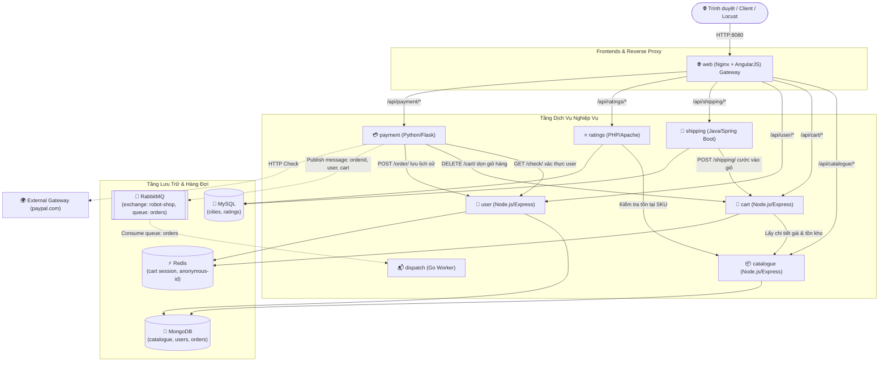
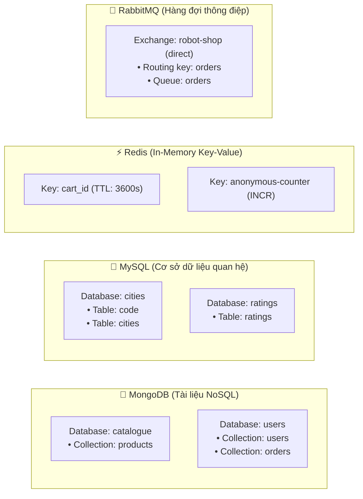
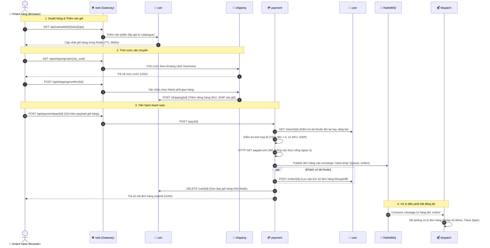
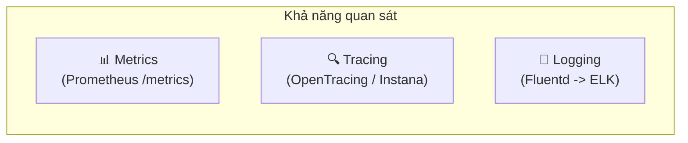
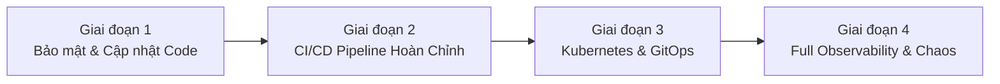

# 🤖 Stan's Robot Shop - DevOps & Cloud-Native Microservices Lab

[](LICENSE)
[](docker-compose.yaml)
[](K8s/helm)
[](K8s/Istio)
[](.github/workflows/push.yml)

> **Stan's Robot Shop** là một ứng dụng thương mại điện tử mô phỏng kiến trúc **Microservices đa ngôn ngữ (Polyglot Microservices)**, được thiết kế chuyên biệt làm môi trường Sandbox cho học tập, nghiên cứu và triển khai thực hành **DevOps, Container Orchestration, Service Mesh, CI/CD, Observability (Giám sát/Tracing/Logging), và Chaos Engineering**.

---

## 📑 Mục lục

1. [Tổng quan dự án](#1-tổng-quan-dự-án)
2. [Kiến trúc hệ thống](#2-kiến-trúc-hệ-thống)
3. [Danh mục Microservices chi tiết](#3-danh-mục-microservices-chi-tiết)
4. [Tầng dữ liệu & Hàng đợi thông điệp](#4-tầng-dữ-liệu--hàng-đợi-thông-điệp)
5. [Luồng nghiệp vụ cốt lõi](#5-luồng-nghiệp-vụ-cốt-lõi)
6. [Cấu trúc thư mục dự án](#6-cấu-trúc-thư-mục-dự-án)
7. [Hướng dẫn cài đặt & Triển khai](#7-hướng-dẫn-cài-đặt--triển-khai)
   - [7.1. Chạy bằng Docker Compose](#71-chạy-cục-bộ-với-docker-compose)
   - [7.2. Kiểm thử tải với Locust (Load Generator)](#72-kiểm-thử-tải-với-locust-load-generator)
   - [7.3. Triển khai Kubernetes với Helm Chart](#73-triển-khai-kubernetes-bằng-helm-chart)
   - [7.4. Triển khai trên OpenShift, Docker Swarm, DC/OS](#74-triển-khai-trên-các-nền-tảng-khác)
   - [7.5. Canary Release & Traffic Shifting với Istio Service Mesh](#75-canary-release--traffic-shifting-với-istio)
8. [Quan sát & Giám sát hệ thống (Observability)](#8-quan-sát--giám-sát-hệ-thống-observability)
9. [Cơ chế tạo lỗi & Thử nghiệm hỗn loạn (Chaos Engineering)](#9-cơ-chế-tạo-lỗi--thử-nghiệm-hỗn-loạn-chaos-engineering)
10. [Hiện trạng bảo mật & Nợ kỹ thuật (Security & Technical Debt)](#10-hiện-trạng-bảo-mật--nợ-kỹ-thuật-security--technical-debt)
11. [Lộ trình cải tiến đề xuất cho DevOps Lab](#11-lộ-trình-cải-tiến-đề-xuất-cho-devops-lab)

---

## 1. Tổng quan dự án

### 1.1. Bối cảnh & Mục đích
- **Tên ứng dụng gốc**: [Stan's Robot Shop](https://github.com/instana/robot-shop) (phát triển bởi Instana - nay thuộc IBM).
- **Mục tiêu sử dụng**: Cung cấp một hệ thống phân tán thực tế có nhiều dịch vụ, nhiều ngôn ngữ lập trình, nhiều loại database và message broker để sinh viên/kỹ sư thực hành các kỹ thuật DevOps hiện đại:
  - Đóng gói container (`Docker`, `Multi-stage build`).
  - Điều phối container (`Docker Compose`, `Kubernetes`, `Helm`, `OpenShift`, `Docker Swarm`).
  - Quản lý mạng & Service Mesh (`Istio` Canary deployment, Ingress Gateway).
  - Giám sát hiệu năng ứng dụng (APM, Distributed Tracing với `Instana/OpenTracing`, Metrics với `Prometheus`).
  - Quản lý và phân tích log tập trung (`Fluentd`, `Elasticsearch/Kibana`).
  - Sinh tải và kiểm thử hiệu năng (`Locust`).

### 1.2. Kịch bản nghiệp vụ
Ứng dụng mô phỏng một cửa hàng trực tuyến bán robot và trí tuệ nhân tạo (AI):
- **Xem sản phẩm**: Danh mục 11 sản phẩm mẫu nạp sẵn từ MongoDB (8 Robot, 2 AI, 1 sản phẩm lai).
- **Đánh giá**: Chấm điểm từ 1 đến 5 sao cho từng robot và xem điểm trung bình.
- **Giỏ hàng**: Quản lý giỏ hàng theo cơ chế phân biệt khách vãng lai (`anonymous-<id>`) và người dùng đã đăng nhập; tự động tính tổng tiền.
- **Tính cước vận chuyển**: Chọn quốc gia, thành phố để tính khoảng cách địa lý theo công thức Haversine từ kho Solingen (Đức) tới địa chỉ giao hàng và quy ra cước vận chuyển USD.
- **Thanh toán & Đơn hàng**: Kiểm tra cổng thanh toán (mô phỏng), lưu lịch sử đơn hàng, xóa giỏ hàng và gửi message sang hàng đợi RabbitMQ để bộ phận điều phối (`dispatch`) xử lý ngầm.

---

## 2. Kiến trúc hệ thống

Hệ thống được xây dựng theo kiến trúc **Microservices phân tán** kết hợp mô hình **API Gateway**:
- **Trình duyệt / Khách hàng**: Chỉ tương tác trực tiếp với duy nhất dịch vụ `web` qua cổng `8080`.
- **API Gateway (`web`)**: Nginx phục vụ Single Page Application (SPA AngularJS) và đóng vai trò Reverse Proxy điều phối toàn bộ các request `/api/<service>/*` tới 6 microservices backend.
- **Giao tiếp liên dịch vụ**:
  - Giao tiếp đồng bộ (Synchronous): Qua giao thức **HTTP/REST**.
  - Giao tiếp bất đồng bộ (Asynchronous): Qua **RabbitMQ AMQP** giữa `payment` và `dispatch`.

### 2.1. Sơ đồ kiến trúc tổng thể (Architecture Diagram)



### 2.2. Ma trận định tuyến API Gateway (Nginx Reverse Proxy)

| Tuyến đường (Route) | Microservice đích | Cổng nội bộ | Mục đích nghiệp vụ |
| :--- | :--- | :--- | :--- |
| `/` | `web` | 8080 | Phục vụ mã nguồn HTML, CSS, JavaScript (AngularJS SPA) |
| `/images/*` | `web` | 8080 | Phục vụ ảnh sản phẩm từ thư mục static (fallback placeholder) |
| `/api/catalogue/*` | `catalogue` | 8080 | Danh mục sản phẩm, tìm kiếm, chi tiết robot |
| `/api/user/*` | `user` | 8080 | Đăng ký, đăng nhập, lịch sử đơn, cấp mã khách |
| `/api/cart/*` | `cart` | 8080 | Thêm/sửa/xóa sản phẩm trong giỏ hàng |
| `/api/shipping/*` | `shipping` | 8080 | Tra cứu mã nước, thành phố, tính cước vận chuyển |
| `/api/payment/*` | `payment` | 8080 | Tiếp nhận thanh toán đơn hàng |
| `/api/ratings/*` | `ratings` | 80 | Đọc và ghi nhận lượt chấm điểm sản phẩm |
| `/nginx_status` | `web` | Nginx internal | Endpoint trạng thái kết nối active của Nginx (Stub Status) |

---

## 3. Danh mục Microservices chi tiết

Hệ thống được cấu thành từ **8 microservices nghiệp vụ** được viết bằng **5 ngôn ngữ lập trình khác nhau**, kèm theo **1 công cụ sinh tải**:

| Service | Công nghệ & Framework | Cổng nội bộ | Phụ thuộc downstream | Chức năng nghiệp vụ & Kỹ thuật |
| :--- | :--- | :--- | :--- | :--- |
| **`web`** | Nginx 1.21.6, AngularJS 1.6.7 | `8080` (Mở ra Host) | 6 backend HTTP services | API Gateway, load balancing, phục vụ client SPA, tích hợp Nginx OpenTracing module. |
| **`catalogue`** | Node.js 14, Express | `8080` | MongoDB | Quản lý thông tin 11 sản phẩm robot/AI, hỗ trợ Text Search `$text`, lọc danh mục, chi tiết theo SKU. Có cờ `GO_SLOW`. |
| **`cart`** | Node.js 14, Express | `8080` | Redis, `catalogue` | Quản lý giỏ hàng theo Cart ID. Tự động gọi `catalogue` đối chiếu giá và kiểm tra tồn kho. TTL Redis 3600s. Xuất `/metrics`. |
| **`user`** | Node.js 14, Express | `8080` | MongoDB, Redis | Cấp định danh `anonymous-<số>`, quản lý đăng nhập/đăng ký người dùng và lịch sử đơn hàng đã đặt. |
| **`shipping`** | Java 8, Spring Boot 2.x | `8080` | MySQL, `cart` | Tra cứu thành phố, tính khoảng cách địa lý theo công thức Haversine từ kho Solingen (Đức) tới địa chỉ giao hàng và gắn cước vào giỏ. Có endpoint `/memory` và `/free`. |
| **`ratings`** | PHP 7.4, Apache, Symfony | `80` | MySQL, `catalogue` | Ghi nhận và tính điểm đánh giá (1-5 sao) cho từng mã SKU robot. Kiểm tra tính hợp lệ của SKU qua `catalogue`. |
| **`payment`** | Python 3.9, Flask, uWSGI | `8080` | `user`, `cart`, RabbitMQ, Internet | Xử lý thanh toán mô phỏng: kiểm tra user, giỏ hàng, kết nối gateway ngoài, tạo order UUID, xóa giỏ hàng, đẩy tin vào RabbitMQ. Xuất `/metrics`. |
| **`dispatch`** | Go 1.17 | *(Không mở cổng)* | RabbitMQ | Background Worker daemon, lắng nghe hàng đợi `orders` từ RabbitMQ, mô phỏng quy trình xuất kho và vận chuyển. Có cờ `DISPATCH_ERROR_PERCENT`. |
| **`load-gen`** | Python 3.9, Locust | *(Không mở cổng)* | `web` | Công cụ sinh tải giả lập người dùng duyệt web, mua hàng, thanh toán với danh sách IP giả lập toàn cầu (Geo-distributed traffic). |

---

## 4. Tầng dữ liệu & Hàng đợi thông điệp

Hệ thống áp dụng mô hình **Polyglot Persistence**, mỗi loại dữ liệu được lưu trữ trên nền tảng phù hợp nhất với bản chất của nó:



### 4.1. Chi tiết các kho lưu trữ

1. **MongoDB (`mongo`)**:
   - Chạy trên cổng `27017`.
   - Cơ sở dữ liệu `catalogue`: Collection `products` chứa 11 mặt hàng robot (UHJ, Watson, HPTD, EMM, CNA, EPE, RED, SHCE, Ewooid, STAN-1, RMC) với chỉ mục tìm kiếm văn bản `$text`. Nạp qua script [`mongo/catalogue.js`](mongo/catalogue.js).
   - Cơ sở dữ liệu `users`: Collection `users` chứa tài khoản người dùng mẫu (`user`, `stan`, `partner-57`) và collection `orders` lưu lịch sử đơn hàng. Nạp qua script [`mongo/users.js`](mongo/users.js).

2. **MySQL Database (`mysql`)**:
   - Chạy trên cổng `3306`.
   - Cơ sở dữ liệu `cities`: Chứa danh sách mã quốc gia (`code`) và bảng thông tin thành phố toàn cầu (`cities`) gồm vĩ độ (latitude) và kinh độ (longitude) lấy từ dữ liệu Maxmind. Nạp qua script [`mysql/scripts/10-dump.sql.gz`](mysql/scripts/10-dump.sql.gz).
   - Cơ sở dữ liệu `ratings`: Bảng lưu điểm đánh giá của từng mã sản phẩm SKU. Nạp qua script [`mysql/scripts/20-ratings.sql`](mysql/scripts/20-ratings.sql).

3. **Redis Cache (`redis`)**:
   - Chạy trên cổng `6379`.
   - Lưu trữ dữ liệu giỏ hàng dưới dạng chuỗi JSON với cơ chế tự hủy: `SETEX <cart-id> 3600 <cart-data>`. Mỗi khi giỏ hàng được cập nhật, TTL được reset lại 1 giờ.
   - Lưu trữ biến đếm tăng dần `anonymous-counter` (INCR) để sinh mã khách định danh vãng lai.

4. **RabbitMQ Message Broker (`rabbitmq`)**:
   - Chạy trên cổng `5672` (AMQP protocol) và `15672` (Management UI).
   - Exchange: `robot-shop` (Loại `direct`, Durable).
   - Routing key: `orders`.
   - Queue: `orders` (Durable).
   - Nội dung thông điệp: JSON chứa `{ "orderid": "<uuid>", "user": "<username/anon-id>", "cart": { ... } }`.

---

## 5. Luồng nghiệp vụ cốt lõi

### 5.1. Luồng mua hàng & Thanh toán (Checkout & Order Dispatch Flow)



### 5.2. Công thức tính cước vận chuyển (Haversine Formula)

Kho hàng của Robot Shop được cố định tại **Solingen, Đức** (Tọa độ: `51.164896° B`, `7.068792° Đ`). Dịch vụ `shipping` tính khoảng cách tới tọa độ của thành phố nhận hàng theo công thức Haversine:

$$d = 2R \times \arcsin \left( \sqrt{\sin^2\left(\frac{\Delta \varphi}{2}\right) + \cos(\varphi_1) \cos(\varphi_2) \sin^2\left(\frac{\Delta \lambda}{2}\right)} \right)$$

*Trong đó $R = 6371\text{ km}$ là bán kính Trái Đất.*

Cước vận chuyển được quy đổi theo khoảng cách:

$$\text{Shipping Cost (USD)} = \frac{\operatorname{round}(\text{Distance (km)} \times 5)}{100}$$

*(Ví dụ: Quãng đường $1000\text{ km} \rightarrow \text{Cước} = \frac{\operatorname{round}(1000 \times 5)}{100} = 50.00\text{ USD}$).*

---

## 6. Cấu trúc thư mục dự án

```plaintext
robot-shop-devops-lab/
├── .github/                      # CI/CD Workflows
│   └── workflows/push.yml        # Tự động build Docker Compose khi push vào master
├── cart/                         # Service Giỏ hàng (Node.js/Express)
│   ├── Dockerfile                # Image build
│   ├── package.json              # Khai báo dependency (@instana/collector, redis, express, prometheus)
│   └── server.js                 # Source code chính
├── catalogue/                    # Service Danh mục sản phẩm (Node.js/Express)
│   ├── Dockerfile
│   ├── package.json
│   └── server.js
├── dispatch/                     # Service Điều phối giao hàng ngầm (Go)
│   ├── Dockerfile                # Multi-stage build Go binary
│   ├── docker-compose.yaml       # Compose phụ cho dispatch test
│   └── main.go                   # RabbitMQ consumer
├── fluentd/                      # Cấu hình thu thập log tập trung
│   ├── Docker-Compose/           # Config Fluentd cho Docker Compose (fluent.conf)
│   ├── Kubernetes/               # Manifest DaemonSet Fluentd cho Kubernetes
│   └── Dockerfile                # Build fluentd kèm plugin Elasticsearch
├── K8s/                          # Triển khai Kubernetes
│   ├── helm/                     # Helm Chart hoàn chỉnh cho Robot Shop
│   │   ├── Chart.yaml            # Định nghĩa Helm chart v1.1.0
│   │   ├── values.yaml           # Các tham số cấu hình (tag, replica, affinities, EUM)
│   │   └── templates/            # Manifest Deployment, Service, StatefulSet (Redis)
│   ├── Istio/                    # Service Mesh Istio manifests
│   │   ├── gateway.yaml          # Ingress Gateway cấu hình routing
│   │   ├── canary.yaml           # DestinationRule & VirtualService tỉ lệ 99:1
│   │   └── payment-deployment-fix.yaml # Bản vá canary cho payment
│   ├── autoscale.sh              # Script hỗ trợ autoscaling
│   ├── load-deployment.yaml      # Deployment Locust chạy trong cụm K8s
│   └── resource-quota.yaml       # Giới hạn tài nguyên (ResourceQuota & LimitRange)
├── load-gen/                     # Công cụ sinh tải tự động (Locust)
│   ├── Dockerfile
│   ├── requirements.txt          # Thư viện locust
│   ├── robot-shop.py             # Kịch bản sinh tải giả lập hành vi người dùng
│   └── load-gen.sh               # Script chạy container sinh tải
├── mongo/                        # Cơ sở dữ liệu MongoDB
│   ├── Dockerfile                # Image MongoDB nạp sẵn dữ liệu khởi tạo
│   ├── catalogue.js              # Script khởi tạo collection sản phẩm
│   └── users.js                  # Script khởi tạo collection người dùng
├── mysql/                        # Cơ sở dữ liệu quan hệ MySQL 5.7
│   ├── Dockerfile                # Image nạp sẵn script SQL
│   ├── scripts/
│   │   ├── 10-dump.sql.gz        # Dump dữ liệu thành phố toàn cầu (Maxmind)
│   │   └── 20-ratings.sql        # Bảng khởi tạo lưu rating
│   └── config.sh                 # Script cấu hình MySQL
├── OpenShift/                    # Cấu hình triển khai Red Hat OpenShift (SCC, route)
├── payment/                      # Service Thanh toán (Python/Flask)
│   ├── Dockerfile
│   ├── payment.py                # Source code chính (xử lý cart, UUID, metrics)
│   ├── rabbitmq.py               # Module publisher kết nối RabbitMQ
│   └── requirements.txt          # Flask, requests, pika, prometheus_client
├── ratings/                      # Service Đánh giá (PHP 7.4/Apache)
│   ├── Dockerfile
│   └── html/                     # Symfony app xử lý API chấm điểm
├── shipping/                     # Service Vận chuyển (Java/Spring Boot)
│   ├── Dockerfile                # Build jar Maven và chạy trên JRE
│   ├── pom.xml                   # Cấu hình Spring Boot dependencies
│   └── src/main/                 # Source code tính toán Haversine, kết nối JPA
├── Swarm/                        # Triển khai Docker Swarm (deploy.sh)
├── DCOS/                         # Triển khai Mesosphere DC/OS (manifests JSON)
├── user/                         # Service Người dùng (Node.js/Express)
│   ├── Dockerfile
│   ├── package.json
│   └── server.js
├── web/                          # Service Web Gateway (Nginx + AngularJS)
│   ├── Dockerfile
│   ├── default.conf.template     # Template Nginx Reverse Proxy
│   ├── entrypoint.sh             # Script render template biến môi trường
│   └── static/                   # Toàn bộ mã nguồn giao diện HTML/CSS/JS
├── .env                          # Biến môi trường mặc định (REPO=robotshop, TAG=2.1.0)
├── docker-compose.yaml           # File dựng 12 containers chạy toàn bộ hệ thống
├── docker-compose-load.yaml      # File Compose chạy bổ sung container Locust
├── pullbaseimages.sh             # Script kéo toàn bộ base image chuẩn
└── README.md                     # Tài liệu hướng dẫn dự án
```

---

## 7. Hướng dẫn cài đặt & Triển khai

### 7.1. Chạy cục bộ với Docker Compose

Đây là cách nhanh nhất để khởi chạy toàn bộ 12 dịch vụ trên máy tính cá nhân.

#### Điều kiện tiên quyết:
- Đã cài đặt [Docker](https://docs.docker.com/get-docker/) và [Docker Compose](https://docs.docker.com/compose/install/) (khuyên dùng Docker Desktop trên Windows/macOS hoặc Docker Engine trên Linux).

#### Bước 1: Chuẩn bị biến môi trường
File `.env` ở thư mục gốc quy định kho image và tag mặc định:
```ini
REPO=robotshop
TAG=2.1.0
```

#### Bước 2: Kéo image có sẵn từ Docker Hub và khởi động
```bash
# Kéo toàn bộ images chính thức về máy
docker-compose pull

# Khởi chạy toàn bộ hệ thống ở chế độ nền (Detached mode)
docker-compose up -d
```

*(Tùy chọn)* Nếu muốn **tự build từ mã nguồn**:
```bash
docker-compose build
docker-compose up -d
```

#### Bước 3: Kiểm tra trạng thái và truy cập
Kiểm tra danh sách container đang chạy:
```bash
docker-compose ps
```

Mở trình duyệt và truy cập:
- **Cửa hàng Robot Shop**: [http://localhost:8080](http://localhost:8080)
- **RabbitMQ Management Dashboard**: Mở container rabbitmq nếu map cổng `15672` (tài khoản mặc định: `guest` / `guest`).

---

### 7.2. Kiểm thử tải với Locust (Load Generator)

Để tạo lưu lượng truy cập liên tục (mô phỏng người dùng mua sắm, chấm điểm, thanh toán), khởi chạy container `load-gen`:

```bash
docker-compose -f docker-compose.yaml -f docker-compose-load.yaml up -d
```

Hoặc chạy độc lập qua script `load-gen.sh`:
```bash
cd load-gen
./load-gen.sh -h <HOST_IP> -r 10 -c 50
```
*Các tham số: `-h` địa chỉ host, `-r` số request/giây, `-c` số người dùng đồng thời.*

---

### 7.3. Triển khai Kubernetes bằng Helm Chart

Thư mục `K8s/helm` chứa Helm Chart đóng gói sẵn mọi Deployment, Service, StatefulSet và RBAC.

#### Yêu cầu:
- Cụm Kubernetes (Minikube, K3s, Kind, EKS, GKE hoặc AKS).
- Công cụ dòng lệnh `kubectl` và `helm` (version 3.x).

#### Các bước triển khai:

```bash
# 1. Tạo namespace riêng biệt cho dự án
kubectl create namespace robot-shop

# 2. Triển khai bằng Helm
helm install robot-shop ./K8s/helm --namespace robot-shop
```

#### Tùy chỉnh tham số khi cài đặt:
Nếu triển khai trên môi trường Minikube hoặc máy cá nhân cần mở cổng NodePort:
```bash
helm install robot-shop ./K8s/helm \
  --namespace robot-shop \
  --set nodeport=true
```

Kiểm tra trạng thái các Pods và Services:
```bash
kubectl get pods -n robot-shop
kubectl get svc -n robot-shop
```

Nếu dùng Minikube, lấy địa chỉ URL để mở trên trình duyệt:
```bash
minikube service web -n robot-shop --url
```

---

### 7.4. Triển khai trên các nền tảng khác

- **Red Hat OpenShift**:
  ```bash
  cd OpenShift
  ./setup.sh
  helm install robot-shop ../K8s/helm --namespace robot-shop --set openshift=true --set ocCreateRoute=true
  ```
- **Docker Swarm**:
  ```bash
  cd Swarm
  ./deploy.sh
  ```
- **Mesosphere DC/OS**:
  ```bash
  cd DCOS
  ./deploy.sh
  ```

---

### 7.5. Canary Release & Traffic Shifting với Istio

Dự án cung cấp sẵn cấu hình mẫu cho Service Mesh [Istio](https://istio.io) trong thư mục `K8s/Istio`:
- **Canary Testing (`K8s/Istio/canary.yaml`)**:
  - Sử dụng `DestinationRule` định nghĩa 2 tập con (subsets): `production` (stage: prod) và `canary` (stage: test).
  - Sử dụng `VirtualService` để phân luồng lưu lượng truy cập: **99%** request đi vào bản `production`, **1%** request đi vào bản `canary` để kiểm thử phiên bản dịch vụ `payment` mới trước khi rollout diện rộng.
- **Ingress Gateway (`K8s/Istio/gateway.yaml`)**: Điều phối lưu lượng từ bên ngoài vào cụm Service Mesh an toàn.

---

## 8. Quan sát & Giám sát hệ thống (Observability)

Dự án tích hợp đầy đủ 3 trụ cột của khả năng quan sát (Three Pillars of Observability):



### 8.1. Thu thập Metrics với Prometheus
Hai microservices `cart` và `payment` được tích hợp sẵn client Prometheus, xuất dữ liệu qua endpoint `/metrics`:

- **Dịch vụ `cart`** (`http://<host>:8080/api/cart/metrics`):
  - `items_added_total`: Counter đếm tổng số lượng sản phẩm được thêm vào giỏ hàng.
- **Dịch vụ `payment`** (`http://<host>:8080/api/payment/metrics`):
  - `sold_count`: Counter đếm tổng số lượng sản phẩm đã thanh toán thành công.
  - `units_sold`: Histogram đo phân bố số lượng sản phẩm trên mỗi đơn hàng (Average Unit Sale).
  - `cart_value`: Histogram đo phân bố tổng giá trị bằng tiền của đơn hàng (Average Value Sale).

Kiểm tra nhanh bằng `curl`:
```bash
curl http://localhost:8080/api/cart/metrics
curl http://localhost:8080/api/payment/metrics
```

### 8.2. Phân tán vết (Distributed Tracing)
Toàn bộ mã nguồn microservices đều đã nhúng các SDK/Sensor OpenTracing và Instana:
- Node.js (`@instana/collector` trên `catalogue`, `cart`, `user`).
- Python (`instana` module trên `payment`).
- Go (`github.com/instana/go-sensor` trên `dispatch`).
- Java (Auto-instrumentation trên `shipping`).
- Nginx (`libinstana_sensor.so` load module trong `web/default.conf.template`).
- Mỗi request đi qua hệ thống đều được đính kèm Context Tracing (Span / Trace ID), giúp đo đạc chính xác độ trễ qua từng chặng mạng.

### 8.3. Thu thập và quản lý Log tập trung (Centralized Logging với Fluentd)
Thư mục `fluentd/` chứa cấu hình gom log từ các container chuyển về **Elasticsearch/Kibana** hoặc **Humio**:
- Chạy qua Docker Compose (`fluentd/Docker-Compose/fluent.conf`).
- Chạy dưới dạng DaemonSet trên Kubernetes (`fluentd/Kubernetes/fluentd.yaml`).

---

## 9. Cơ chế tạo lỗi & Thử nghiệm hỗn loạn (Chaos Engineering)

Hệ thống được thiết kế sẵn các "công tắc" (Environment Variables & Endpoints) để cố tình tạo ra sự cố, hỗ trợ huấn luyện khả năng phản ứng và cấu hình cảnh báo (Alerting):

| Biến / Endpoint | Dịch vụ | Loại sự cố | Mô tả chi tiết hành vi |
| :--- | :--- | :--- | :--- |
| `GO_SLOW` | `catalogue` | Độ trễ cao (Latency) | Nhận giá trị thời gian tính bằng mili-giây (ms). Tự động hoãn phản hồi của API `GET /product/:sku` để kiểm thử timeout và degrade performance. |
| `PAYMENT_DELAY_MS` | `payment` | Tắc nghẽn thanh toán | Tạo thời gian sleep trước khi publish tin vào RabbitMQ, gây dồn ứ đơn hàng và nghẽn tài nguyên. |
| `DISPATCH_ERROR_PERCENT` | `dispatch` | Tỷ lệ lỗi (Error Rate) | Tỷ lệ phần trăm (0 - 100) các đơn hàng trong queue `orders` bị worker đánh dấu lỗi `"Failed to dispatch to SOP"`. |
| `GET /memory` | `shipping` | Rò rỉ bộ nhớ (Memory Leak) | Mỗi lần gọi sẽ cấp phát thêm một mảng byte `25MB` vào biến tĩnh toàn cục, giúp mô phỏng Out-Of-Memory (OOMKilled) trên Pod. |
| `GET /free` | `shipping` | Dọn bộ nhớ (Memory Cleanup) | Xóa sạch toàn bộ mảng byte đã cấp phát trong bộ nhớ để hệ thống phục hồi. |

---

## 10. Hiện trạng bảo mật & Nợ kỹ thuật (Security & Technical Debt)

> [!WARNING]
> Bản chất Robot Shop là ứng dụng **Sandbox để học tập**, mã nguồn gốc **chưa được thiết kế sẵn sàng cho môi trường Production (Chưa đạt chuẩn bảo mật)**. Dưới đây là các phát hiện quan trọng cần nắm rõ khi thực hiện đồ án:

### 10.1. Danh mục lỗ hổng bảo mật nghiêm trọng

1. **Lộ toàn bộ dữ liệu người dùng qua API công khai**:
   - Endpoint `GET /api/user/users` mở công khai ra Internet thông qua Gateway `web`.
   - Bất kỳ ai cũng có thể đọc danh sách toàn bộ tài khoản kèm **mật khẩu dạng văn bản thô (Plaintext)** (`user/server.js:104`).
2. **Mật khẩu lưu trữ dạng Plaintext & Ghi log nhạy cảm**:
   - Mật khẩu lưu trong MongoDB không băm (không dùng bcrypt hay Argon2).
   - Cơ chế đăng nhập so sánh trực tiếp chuỗi: `user.password == req.body.password`.
   - API `/login` và `/register` ghi thẳng `req.body` (chứa cả mật khẩu người dùng) ra stdout log (`user/server.js:119, 149`).
3. **Thông tin xác thực (Credentials) bị ghi cứng (Hardcoded)**:
   - MySQL: Tài khoản `shipping/secret` và `ratings/iloveit` bị ghi cứng trong mã nguồn. Root password mặc định không được thiết lập.
   - RabbitMQ: Dùng cứng tài khoản `guest/guest` trong mã nguồn của cả `payment` và `dispatch`.
   - MongoDB: Hoàn toàn không bật cơ chế xác thực (No Authentication).
4. **Thay đổi trạng thái dữ liệu bằng phương thức HTTP GET**:
   - Các API thêm/sửa/xóa sản phẩm trong giỏ hàng đều sử dụng phương thức `GET` (`/api/cart/add/...`, `/api/cart/update/...`), vi phạm tiêu chuẩn RESTful và có nguy cơ bị tấn công CSRF.
5. **Rủi ro phụ thuộc bên ngoài khi thanh toán**:
   - Dịch vụ `payment` gửi HTTP GET tới `https://paypal.com/` mỗi khi xử lý giao dịch. Nếu mất kết nối Internet, toàn bộ quá trình thanh toán sẽ bị gián đoạn.

### 10.2. Base Images đã hết vòng đời hỗ trợ (End of Life)

| Thành phần | Base Image gốc | Trạng thái hỗ trợ | Khuyến nghị nâng cấp |
| :--- | :--- | :--- | :--- |
| `cart`, `catalogue`, `user` | `node:14` | Hết hỗ trợ (Tháng 4/2023) | Nâng cấp lên `node:20-alpine` hoặc `node:22-alpine` |
| `dispatch` | `golang:1.17` | Hết hỗ trợ (Tháng 8/2022) | Nâng cấp lên `golang:1.22-alpine` |
| `ratings` | `php:7.4-apache` | Hết hỗ trợ (Tháng 11/2022) | Nâng cấp lên `php:8.2-apache` |
| `shipping` | `debian:10` / `openjdk:8-jdk` | Hết hỗ trợ (Tháng 6/2024) | Nâng cấp lên Eclipse Temurin `eclipse-temurin:17-jre-alpine` |
| `payment`, `load-gen` | `python:3.9` | Hết hỗ trợ (Tháng 10/2025) | Nâng cấp lên `python:3.11-slim` hoặc `python:3.12-alpine` |
| `mysql` | `mysql:5.7` | Hết hỗ trợ (Tháng 10/2023) | Nâng cấp lên `mysql:8.0` hoặc `mariadb:10.11` |
| `mongo` | `mongo:5` | Hết hỗ trợ (Tháng 10/2024) | Nâng cấp lên `mongo:6.0` hoặc `mongo:7.0` |

---

## 11. Lộ trình cải tiến đề xuất cho DevOps Lab

Dành cho các nhóm sinh viên và kỹ sư thực hiện **Đồ án chuyên ngành / Khóa luận tốt nghiệp**:



1. **Giai đoạn 1: Chuẩn hóa bảo mật & Tái cấu trúc Container**:
   - [ ] Nâng cấp các base image sang phiên bản LTS mới nhất (Alpine/Distroless).
   - [ ] Triển khai Multi-stage Dockerfile nhằm tối ưu kích thước image và loại bỏ compiler thừa trong runtime.
   - [ ] Băm mật khẩu người dùng với `bcrypt` và đóng endpoint `/api/user/users`.
   - [ ] Chuyển toàn bộ mật khẩu, chuỗi kết nối DB ra biến môi trường và nạp qua Kubernetes Secrets.
2. **Giai đoạn 2: Tự động hóa CI/CD**:
   - [ ] Xây dựng GitHub Actions / GitLab CI pipeline gồm các stages: Linting, Unit Test, Quét lỗ hổng image (`Trivy`), Build Docker image và Push lên Container Registry (Docker Hub / GitHub Container Registry / Harbor).
3. **Giai đoạn 3: Điều phối Kubernetes nâng cao & GitOps**:
   - [ ] Bổ sung `HorizontalPodAutoscaler` (HPA) cho các service stateless dựa trên CPU/Memory metrics.
   - [ ] Cấu hình PersistentVolumeClaim (PVC) cho MongoDB và MySQL để đảm bảo tính toàn vẹn dữ liệu khi Pod restart.
   - [ ] Ứng dụng mô hình GitOps triển khai tự động qua **ArgoCD**.
4. **Giai đoạn 4: Giám sát toàn diện (Observability) & Kiểm thử hỗn loạn**:
   - [ ] Triển khai **Prometheus Operator** và xây dựng Dashboard trực quan trên **Grafana**.
   - [ ] Tích hợp **OpenTelemetry (OTel)** Collector thay thế sensor độc quyền Instana để chuẩn hóa Tracing sang **Jaeger/Tempo**.
   - [ ] Thực hiện Chaos Engineering với **Chaos Mesh** hoặc **LitmusChaos** dựa trên các công tắc lỗi có sẵn.

---

## 📄 Bản quyền & Tham chiếu

- **Dự án gốc**: [instana/robot-shop](https://github.com/instana/robot-shop) (Bản quyền thuộc sở hữu của Instana / IBM).
- **Giấy phép**: Mã nguồn được phân phối theo giấy phép [Apache License 2.0](LICENSE).
- **Tài liệu đồ án liên quan**: Xem thêm [Báo cáo khảo sát ứng dụng Stan's Robot Shop.md](Báo%20cáo%20khảo%20sát%20ứng%20dụng%20Stan's%20Robot%20Shop.md) để nắm rõ chi tiết phân tích từng dòng mã nguồn.
